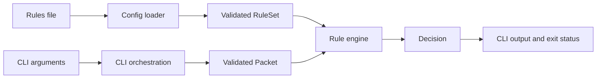

# Firewall architecture plan

Status: proposed architecture; implementation has not started.

## Goal and first milestone

Build a CLI rule simulator first, then extend it into a live firewall. This
sequence was selected with the project owner. Use each milestone to learn
firewall architecture, build systems, and effective testing in C++.

Keep the implementation in C11 and write new tests in C++17. The simulator takes
packet metadata as input and explains an allow/block decision. Live enforcement
will be a separate milestone with its operating system selected later.

The initial model is stateless: each decision depends on one packet and the
current rules. Connection history, NAT, IPv6, application inspection, and
concurrent rule reloads are later design exercises.

## Current baseline

- `src/core/firewall_rules.c` implements exact matching and first-match ordering.
- Seven existing C tests pass for matching, disabled rules, ordering, and defaults.
- `src/cli/main.c` contains an incomplete parser and command dispatcher.
- The Makefile builds a core object and tests, but has no CLI executable target.
- Controller, storage, common, and platform directories are empty.

The CLI's incomplete parsing, uninitialized decision, UDP assignment, command
comparisons, and version handling need correction during implementation.

## Component boundaries



| Component | Responsibility | Dependencies |
| --- | --- | --- |
| Core | Packet/rule types, matching, ordered evaluation | Standard C types |
| Config | Parse and validate rule files; produce a complete ruleset | Core, file I/O, address conversion |
| CLI | Parse arguments, call config/core, format output | Config and core |
| Platform, later | Receive live packets, decode metadata, apply verdicts | Core and selected OS APIs |

The core receives data and returns a result. It performs no file I/O, argument
parsing, printing, process termination, or OS enforcement. This makes its
behavior directly testable and reusable by a future live packet path.

Initially, orchestration fits in CLI helper functions. Add a controller module
when a long-running packet loop or rule reload lifecycle needs one. Likewise,
add persistence when there is something beyond reading a configuration file.

## Data and ownership

Use four explicit types:

- `Packet`: protocol, source/destination IPv4 addresses, and ports.
- `Rule`: unique ID, enabled flag, action, protocol mask, and matching fields.
- `RuleSet`: ordered rules, count, and default action.
- `Decision`: action, whether a rule matched, and matching rule ID.

Start with a caller-owned fixed-capacity `RuleSet` containing at most 1024 rules,
matching the current capacity constant. Avoid global rule tables. Pass rulesets
by const pointer during evaluation; ownership stays with the caller. Dynamic
storage can be a later exercise once the fixed-capacity contract is tested.

Keep IPv4 addresses and ports in host byte order inside the model, consistent
with the current tests. Convert addresses at the input boundary. The core does
not compare text addresses or raw network-order fields.

A decision contains no borrowed rule pointer and does not copy the whole rule.
Use ID 0 for the default decision and reserve nonzero IDs for configured rules.
An explicit matched flag makes the reason for the decision clear.

The existing packet direction field is unused. Version 1 does not match
direction; document this in the CLI. Add direction to both rules and packet
input together in the feature-expansion milestone.

## Version 1 behavior contract

1. Evaluate enabled rules in file order. IDs identify rules; they do not set
   priority. The first matching rule wins.
2. Match source/destination addresses and ports exactly. Protocol matches when
   the packet's single protocol is included in the rule's protocol mask.
3. Default to block. Allow an explicit `--default allow|block` override for
   experiments. An empty valid ruleset uses this default.
4. Treat port 0 and address `0.0.0.0` as literal values. Wildcards and CIDR
   require explicit representations in a later version.
5. Invalid packet input or configuration produces an error, not a policy
   decision. A parser failure must never leave partially loaded rules available
   for evaluation.
6. Evaluation does not mutate the packet or ruleset. The same inputs produce
   the same result.

Keep operational errors separate from allow/block. Suggested API shapes are:

```c
/* Sketches: names and status types can be refined during implementation. */
FwStatus load_rules(FILE *input, Firewall_Action default_action,
                    RuleSet *out, ParseError *error);
FwStatus evaluate_packet(const Packet *packet, const RuleSet *rules,
                         Decision *out);
```

`FILE` and parse diagnostics belong in the config header. Core headers expose
only model types and evaluation functions. Validate pointers, counts, and enum
values at public API boundaries; define output as unchanged on failure. Use
`size_t` for counts and pass default actions by value.

## Configuration and CLI

Retain the existing eight-field format for the first version:

```text
# id enabled action protocol src_ip src_port dest_ip dest_port
1 enabled allow tcp 10.0.0.1 50000 10.0.0.2 443
2 disabled block udp 10.0.0.3 53000 10.0.0.4 53
```

The loader accepts blank lines, full-line comments, and trailing comments
starting with `#`. Every other line must contain exactly eight fields. It
rejects invalid keywords, malformed IPv4 addresses, missing/extra fields,
duplicate IDs, numeric overflow, and capacity overflow. IDs must fit `uint64_t`
and be nonzero; ports must be in 0..65535. The initial file syntax accepts
`tcp` or `udp`; combined protocol syntax can be added later.

Report the filename, line, and offending field through the CLI. Define an
explicit maximum line length and reject overlong lines without interpreting
the remainder as another rule. Build a temporary ruleset, then publish it to
the caller only after the entire file validates.

Use the same loader for all rule commands:

```text
firewall rules validate rules.conf
firewall rules list --rules rules.conf
firewall check --rules rules.conf --protocol tcp \
  --src-ip 10.0.0.1 --src-port 50000 \
  --dest-ip 10.0.0.2 --dest-port 443
firewall help
firewall version
```

Suggested check output: `ALLOW rule=1` or `BLOCK default`.

For `check`, use exit status 0 for allow, 1 for block, and 2 for usage/config/I/O
errors. Other commands use 0 for success and 2 for errors. Print normal output
to stdout and diagnostics to stderr. Reject unknown and duplicate options;
require all packet fields for `check`.

## Build system and C++ tests

First explain the current Makefile through the compilation pipeline:
source -> object file -> static library -> executable. Teach header dependencies,
compiler options, linker inputs, and incremental rebuilds using this project.

Then introduce a target-based CMake build with these targets:

| Target | Language | Purpose |
| --- | --- | --- |
| `firewall_core` | C11 | Static library for model and evaluation |
| `firewall_config` | C11 | Static library linking to the core |
| `firewall` | C11 | CLI executable linking to config and core |
| `firewall_tests` | C++17 | GoogleTest executable linking to the C libraries |

Compile `.c` files as C and `.cpp` files as C++. Guard exported C function
declarations with `extern "C"` under `__cplusplus` so C++ tests can link to the
C implementation. Give headers direct, minimal includes instead of importing
every library through `libraries.h`.

Use GoogleTest for named assertions and parameterized tests. Pin its dependency
to a reviewed release/commit and provide a local dependency option for offline
builds. Fetch it only when testing is enabled. Register tests with CTest.
GoogleTest's [CMake quickstart](https://google.github.io/googletest/quickstart-cmake.html)
documents C++17, linking, and discovery; CMake's
[testing tutorial](https://cmake.org/cmake/help/latest/guide/tutorial/Testing%20and%20CTest.html)
explains test registration and execution.

Planned developer commands, available after the build milestone:

```sh
cmake -S . -B build -DCMAKE_BUILD_TYPE=Debug
cmake --build build
ctest --test-dir build --output-on-failure
```

Use target-specific warnings and optional AddressSanitizer/UndefinedBehaviorSanitizer
settings for development builds on supported compilers. Once CMake is the
canonical build definition, the Makefile can delegate to it; avoid maintaining
two independent source lists. Retain the earlier Makefile example in the build
notes for comparison.

## Test strategy

Test externally visible behavior and contracts rather than internal control flow.

| Layer | Meaningful cases |
| --- | --- |
| Core unit tests | Each mismatching field, TCP/UDP masks, disabled rules, conflicting rules in both orders, empty ruleset, both default actions |
| Boundary tests | Invalid public API inputs, invalid enum values, maximum count, inputs unchanged by evaluation |
| Parser tests | Valid examples, comments, missing/extra fields, invalid IPs, port boundaries, overflow, duplicate IDs, long lines, capacity limit |
| Parser integration | Error on a later line leaves the previous output ruleset unchanged |
| CLI integration | Full file-to-decision path, matching/default output, allow/block/error exit statuses, help/version and argument errors |

Preserve the behavior covered by all seven existing C tests while moving it to
C++ tests. Add parameterized cases for independent field mismatches and numeric
boundaries. Use temporary files for file integration tests and run the actual
CLI executable for command tests. The core needs no mocks. Add test doubles
only when an external boundary needs one, such as a future packet source.

## Delivery milestones

1. **Build foundation:** explain the existing Makefile; establish C libraries,
   CMake targets, C++ linkage, and GoogleTest/CTest. Verify the current seven
   behaviors through tests linked to the C core.
2. **Core contract:** introduce owned `RuleSet` and compact `Decision` types,
   remove rule globals, define error handling, and test ordering/defaults and
   input boundaries.
3. **Simulator:** implement the strict config loader and CLI commands. Done
   when validate/list/check work end to end with the documented output and exit
   statuses, including malformed-input tests.
4. **Policy expansion:** add direction, CIDR, wildcards, and port ranges one at
   a time. Define their semantics before changing the parser and matching tests.
5. **Live firewall:** select one OS and add packet acquisition, decoding, and
   verdict enforcement around the same engine. Specify unsupported protocols,
   fragments, truncated packets, queue failures, and startup/shutdown behavior.
6. **Stateful exercise:** introduce flow state and expiry to compare stateless
   filtering with connection-aware decisions; revisit how policy updates affect
   existing flows.

For milestone 5, distinguish reading packets from enforcing decisions. A future
adapter must provide both an input path and an actual verdict path. Linux
NFQUEUE is one candidate: its userspace API receives kernel-queued packets and
returns accept/drop verdicts, as described by
[Netfilter](https://netfilter.org/projects/libnetfilter_queue/doxygen/html/).
The platform choice remains open; no Linux/macOS backend abstraction needs to
be implemented for the simulator.

Keep the first implementation single-threaded with a linear rule scan. Measure
its behavior before considering indexes, concurrent readers, a daemon, or a
management API. Each later feature should answer a concrete learning question
and have a behavior contract we can verify.
